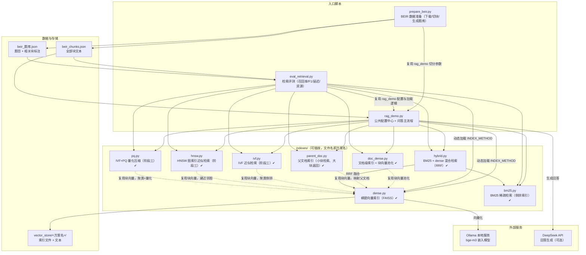

# RAG 索引评测框架（RAG Index Benchmark）

一个可插拔索引方案的检索增强生成（RAG）系统与检索评测框架：以 BEIR 基准为评测数据源，对不同的索引方案（稠密向量、稀疏检索、混合检索、父文档索引……）进行统一的召回率、精确率、延迟与资源占用评测，并支持一键切换索引方案运行问答。

- **本地嵌入**：Ollama + bge-m3（多语言嵌入模型），无需云端嵌入 API
- **本地索引**：FAISS 向量索引，向量数据落盘本地
- **生成模型**：DeepSeek（仅问答模式需要）
- **评测基准**：BEIR（nfcorpus），自动将文档级标注转换为块级题库

## 核心特点

1. **可插拔索引方案**：每个索引方案是 [indexes/](indexes/) 目录下的一个独立脚本，只需实现 `build_index(chunks, config)` 和 `search(question, config)` 两个函数；主程序通过配置区 `INDEX_METHOD` 一键切换，主程序零改动（接口约定见 [indexes/README.md](indexes/README.md)）。
2. **完整的评测闭环**：逐题检索并自动比对标注，输出多档位（Top-1/5/10/20/50）召回率、精确率、F1、题目命中率，以及建库耗时、查询延迟、内存/磁盘占用。
3. **评测与运行同配置**：评测脚本直接复用主程序的配置与索引方案加载逻辑，不存在"评测一套、运行一套"的配置不一致问题。
4. **BEIR 基准数据源**：`prepare_beir.py` 自动下载数据集并生成块级题库，评测与问答共用同一份数据。

## 架构图



**一次问答的数据流：**


## 快速开始

### 环境要求

| 依赖 | 说明 |
|---|---|
| Python 3.11+ | 运行环境 |
| Ollama | 本地嵌入服务，需 `ollama pull bge-m3` |
| DeepSeek API Key | 可选，仅"生成回答"模式需要；纯检索评测不需要 |

### 安装与运行

```bash
# 1. 安装 Python 依赖
pip install openai langchain-text-splitters langchain-core faiss-cpu numpy certifi
# 可选：评测内存占用需要 psutil
pip install psutil

# 2. 启动 Ollama 并拉取嵌入模型（需先安装 Ollama 并启动服务）
ollama pull bge-m3

# 3. 准备 BEIR 数据（自动下载 nfcorpus 数据集，切块并生成块级题库）
python prepare_beir.py

# 4. 构建索引并跑完整评测（输出 评测报告_<方案名>_beir.txt，方案由 INDEX_METHOD 决定）
python eval_retrieval.py

# 5. 运行问答示例（需先设置 DEEPSEEK_API_KEY 环境变量）
python rag_demo.py
```

### 常用参数（在 [rag_demo.py](rag_demo.py) 配置区修改）

| 参数 | 默认值 | 说明 |
|---|---|---|
| `INDEX_METHOD` | `"dense"` | 索引方案名 = `indexes/` 下的文件名（不含 .py） |
| `RETRIEVE_ONLY` | `False` | 置 `True` 只打印检索片段不调大模型，快速对比方案召回 |
| `N_RESULTS` | `3` | 问答模式召回片段数 |
| `CHUNK_SIZE` / `CHUNK_OVERLAP` | `500` / `50` | 文档切分参数 |
| `EMBEDDING_MODEL` | `"bge-m3"` | Ollama 中的嵌入模型名 |

评测参数（召回档位、查询重复次数、数据源模式等）在 [eval_retrieval.py](eval_retrieval.py) 配置区修改。

## 评测结果（方案对比）

**评测环境**：nfcorpus 数据集 ｜ 语料 3633 篇文档切为 17071 块 ｜ 119 道题（仅有强相关标注的题） ｜ 嵌入模型 bge-m3（本地 CPU）｜ dense/doc_dense 检索方式为 FAISS 暴力检索（IndexFlatIP + L2 归一化，即余弦相似度）

**评测口径**：BEIR 的 qrels 为文档级标注，本框架按官方方式做**文档级命中判断**——检索片段经"文本反查块编号 → 块编号映射来源文档"后与相关文档比对；相关判定采用 **BEIR 官方口径：仅强相关（score=2）算相关**（nfcorpus 弱相关标注占 95.3%，若把弱相关也算相关，每题平均相关文档多达 38 篇、最多 475 篇，召回率会被严重稀释，详见 [prepare_beir.py](prepare_beir.py) 注释）。按此口径 nfcorpus 仅 119 道题有强相关标注，每题平均约 4.8 篇强相关文档。

### 方案对比总表

| 方案 | Recall@5 | Recall@10 | Recall@20 | Recall@50 | 建库耗时 | 平均查询延迟 | 索引文件大小 |
|---|---|---:|---:|---:|---:|---:|---:|---:|
| parent_doc（父文档：小块检索大块返回） | 29.35% | 36.06% | 44.61% | 53.79% | 0.09 秒 | 230.6 毫秒 | 15 MB（复用子索引） |
| hybrid（BM25+dense，RRF 融合） | 26.55% | 31.85% | 41.32% | 53.57% | 3.43 秒 | 230.1 毫秒 | 88 MB（含子索引） |
| doc_dense（文档级索引，块向量池化） | 32.12% | 38.54% | 44.56% | 52.24% | 4.28 秒 | 243.6 毫秒 | 15 MB |
| dense（稠密向量，基线） | 27.30% | 32.11% | 41.17% | 50.28% | 220.27 秒 | 45.9 毫秒※ | 73 MB |
| ivf（IVF 近似检索，nprobe=32） | 26.48% | 31.82% | 39.00% | 48.68% | 0.65 秒 | 196.2 毫秒 | 74 MB |
| hnsw（HNSW 图索引近似检索，ef_search=64） | 26.32% | 32.17% | 40.55% | 50.14% | 2.37 秒 | 208.0 毫秒 | 77 MB |
| pq（IVF+PQ 量化压缩，M=32/nprobe=32） | 19.38% | 22.72% | 30.32% | 40.31% | 8.46 秒 | 34.7 毫秒※ | 9 MB |
| bm25（稀疏倒排） | 21.87% | 27.94% | 34.28% | 44.80% | 3.24 秒 | 2.6 毫秒 | 15 MB |

> **口径说明**（对比前必读）：
>
> - **建库耗时**：dense 含 17071 块全量向量化（本地 CPU 跑 bge-m3，占总耗时绝大部分）；doc_dense 与 parent_doc 复用已有块向量（分别做池化/直接复用），零向量化成本（从零建库须先有块向量，即 dense 的建库耗时为其前置成本）；bm25 纯 CPU 构建倒排索引，无需向量化；hybrid 的 3.43 秒是复用已有 dense 子索引（跳过向量化）后的耗时，从零建库 = 3.24 + 220.27 秒；ivf 与 hnsw 同样复用 dense 的块向量（分别做 k-means 训练/建图），零向量化成本。
> - **查询延迟**：dense / doc_dense / hybrid / parent_doc 为端到端延迟（含问题向量化，预热后 3 次取平均）；bm25 无需向量化问题，2.6 毫秒即纯检索耗时。dense 行的 45.9 毫秒为 2026-10-11 重测的干净值（旧值 1948.8 毫秒混入一次 Ollama 卡顿离群值，单题最慢 55.0 万毫秒，已弃用；重测时 Ollama 负载低，故明显低于其余方案的约 230 毫秒）。pq 行的 34.7 毫秒为 2026-10-07 实测，数值差异同样来自 Ollama 服务状态变化——**方案间的延迟比较以纯检索微基准（bench_retrieval.py / pq_curve.py）为准**，端到端延迟仅作展示参考。
> - **重测说明**：dense 行为 2026-10-11 重跑（--skip-build，同索引），Recall@20 由 41.23% 微调为 41.17%，其余档位不变；重测批次间查询向量化存在 ±0.1pp 内的微差，检索行为未变。
> - **索引文件大小**：`vector_store/<方案目录>/` 实际磁盘占用（2026-09-26 实测）；hybrid 复用 bm25 与 dense 两个子索引（15 + 73 MB），parent_doc 复用 dense 块向量索引、自身仅落盘 0.04 MB 元信息。
> - 完整档位数据（含精确率、F1、题目命中率）见各方案报告：[评测报告_parent_doc_beir.txt](评测报告_parent_doc_beir.txt)（2026-10-03）、[评测报告_hybrid_beir.txt](评测报告_hybrid_beir.txt)（2026-10-03）、[评测报告_doc_dense_beir.txt](评测报告_doc_dense_beir.txt)（2026-10-03）、[评测报告_dense_beir.txt](评测报告_dense_beir.txt)（2026-10-11）、[评测报告_bm25_beir.txt](评测报告_bm25_beir.txt)（2026-10-03）、[评测报告_ivf_beir.txt](评测报告_ivf_beir.txt)（2026-10-03）、[评测报告_hnsw_beir.txt](评测报告_hnsw_beir.txt)（2026-10-04）、[评测报告_pq_beir.txt](评测报告_pq_beir.txt)（2026-10-07）。

### 与 BEIR 官方基线的对照（外部基线）

本项目的块级评测指标是 Recall@K（针对"相关块"的召回）；BEIR 论文的核心指标是文档级 NDCG@10（全量 qrels、文档级检索、不截断）。为回答"我的实现在文献里是什么水平"，用官方口径复测（[experiments/doc_retrieval_full.py](experiments/doc_retrieval_full.py)，nfcorpus，全量 qrels）：

| 系统 | NDCG@10（nfcorpus，官方口径） |
|---|---:|
| **本项目：bge-m3 + 文档级全文检索** | **0.3867** |
| BGE-large-v1.5（BEIR 论文基线） | 0.380 |
| SPLADE++（BEIR 论文基线） | 0.347 |
| BM25 Lucene（BEIR 论文基线） | 0.325 |
| TAS-B / GenQ（BEIR 论文基线） | 0.319 |
| SBERT-msmarco（BEIR 论文基线） | 0.272 |

结论：裸 bge-m3 + 文档级检索即达到 BEIR 论文中 BGE-large-v1.5 的水平（0.3867 vs 0.380），显著超过经典稀疏基线 BM25（+6.2pp）——嵌入管线无实质损伤、检索实现与官方口径可比。基线数字来自 BEIR 原论文（Thakur et al. 2021）的 nfcorpus nDCG@10，复测数据见 `experiments/reports/实验总结报告.txt`（方案 A 全文行）。

### 题目命中率对比（第二展示指标）

题目命中率（Hit）= 至少召回一个强相关文档的题目占比。它与 Recall 的差别：Recall 被"每题相关文档数量与标注密度"牵着走，而命中率只看"是否捞到"，2026-10-03 评测口径修正前后命中率几乎不变（对比旧口径报告即可验证），是稳定性最强的指标，适合作为召回率之外的第二展示指标。数据取自各方案报告的"全部有标注题汇总"块：

| 方案 | Hit@5 | Hit@10 | Hit@20 | Hit@50 |
|---|---:|---:|---:|---:|
| parent_doc（父文档：小块检索大块返回） | 58.82% | 63.87% | 75.63% | 81.51% |
| hybrid（BM25+dense，RRF 融合） | 57.98% | 63.03% | 72.27% | **84.03%** |
| doc_dense（文档级索引，块向量池化） | **64.71%** | **70.59%** | **76.47%** | 82.35% |
| dense（稠密向量，基线） | 55.46% | 61.34% | 71.43% | 79.83% |
| ivf（nprobe=32） | 53.78% | 62.18% | 68.91% | 77.31% |
| hnsw（ef_search=64） | 53.78% | 61.34% | 69.75% | 78.15% |
| pq（M=32/nprobe=32） | 46.22% | 48.74% | 57.14% | 68.91% |
| bm25（稀疏倒排） | 45.38% | 53.78% | 63.87% | 75.63% |

**命中率角度的新观察**：Hit@50 冠军是 hybrid（84.03%），而非 Recall@50 冠军 parent_doc——RRF 融合的关键词信号在"每题至少兜住一个相关文档"上能力最强；而 Hit@5 冠军仍是 doc_dense（64.71%），与 Recall 浅档位结论一致。可见"兜底命中"与"平均召回量"是两个不同的维度，答辩时是两个独立卖点。

### 多数据集评测：scifact（结论交叉验证）

nfcorpus 查询是标题式短语、标注密度大（每题平均 38+ 个相关文档），上述结论可能被数据集特性绑架。为此在 scifact（科学事实核查：5183 文档 → 23329 块，300 题，每题平均 5.4 个相关块，官方口径 score≥1 即相关，实测 qrels 为二值标注）上重跑 5 个方案（ivf/hnsw/pq 是 dense 的近似加速方案，随后补跑）：

| 方案 | Recall@5 | Recall@10 | Recall@20 | Recall@50 | Hit@50 |
|---|---:|---:|---:|---:|---:|
| bm25（稀疏倒排） | 63.50% | 71.28% | 78.47% | 84.18% | 86.00% |
| dense（稠密向量，基线） | 67.81% | 73.31% | 80.30% | 87.16% | 87.67% |
| doc_dense（文档级索引） | 69.36% | 77.18% | 82.81% | 87.49% | 88.00% |
| hybrid（BM25+dense，RRF 融合） | **72.99%** | **79.20%** | **84.75%** | **89.66%** | **90.00%** |
| parent_doc（父文档索引） | 68.63% | 76.40% | 83.59% | 87.60% | 88.00% |
| ivf（IVF 近似检索，nprobe=32） | 65.64% | 70.87% | 77.13% | 84.09% | 85.00% |
| hnsw（HNSW 图索引，ef_search=64） | 66.48% | 71.97% | 77.97% | 85.82% | 86.33% |
| pq（IVF+PQ 量化压缩，M=32/nprobe=32） | 48.54% | 56.20% | 64.01% | 72.81% | 73.67% |

（评测报告：2026-10-12，见 `评测报告_*_scifact_beir.txt`）

**跨数据集结论复核（重要，复试讲新版本）**：

1. **RRF"浅档位稀释"被证伪，实为 nfcorpus 查询类型特有**：scifact 上 hybrid 全档位冠军，且浅档位加成最大（@5 比 dense 高 5.18pp、@50 高 2.50pp）。原因：nfcorpus 查询是标题式短语，bm25 词法信号在浅档位挤占名额引入噪声；scifact 查询是完整陈述句，关键词信号本身高质量，融合全档位受益。**修正结论：RRF 融合在查询词与相关文档词面重叠高的数据集上全档位有效；浅档位稀释只出现在短语式查询上。**
2. **"浅档位文档级更准、深档位块级更全"方向跨数据集稳定，效应幅度变小**：doc_dense vs parent_doc，scifact 上 @5 高 0.73pp、@20 被反超 0.78pp（nfcorpus 上分别为 2.77/1.55pp）。检索粒度结论的方向可推广，数值差异属数据集特性。
3. **"dense 弱势"是 nfcorpus 特性**：scifact 上 dense（67.81%）全面反超 bm25（63.50%），nfcorpus 上 dense 却几乎垫底。不同数据集的 sparse/dense 强弱对比不同，单数据集结论必须注明数据集。
4. **题目命中率跨数据集更稳健**：Recall 从 nfcorpus 到 scifact 翻倍以上（bm25 44.80%→84.18%），Hit@50 只从 75.63% 变到 86.00%——命中率受标注密度影响小，跨数据集可比性强，验证了它作为第二展示指标的设计初衷。
5. **近似索引的召回损失幅度也是数据集相关的**：同为 nprobe=32，ivf 在 scifact 上损失 3.07pp（87.16→84.09%）、nfcorpus 上仅 1.6pp；hnsw ef=64 损失 1.34pp（nfcorpus 0.14pp）；pq M=32 损失 14.35pp（nfcorpus 9.97pp）。即整体召回越高的数据集（scifact），近似索引的绝对损失也越大——"甜蜜点"配置（nprobe/ef_search/M）的绝对损失数字需要在目标数据集上实测，不能跨数据集直接沿用。

### 多数据集评测：fiqa（第三个数据集）

fiqa（金融问答：57.6k 文档 → 119657 块，648 题，每题平均 7.1 个相关块，二值标注）：

| 方案 | Recall@5 | Recall@10 | Recall@20 | Recall@50 | Hit@50 |
|---|---:|---:|---:|---:|---:|
| parent_doc（父文档索引） | **35.30%** | **44.12%** | **51.13%** | **62.46%** | **81.17%** |
| dense（稠密向量，基线） | 34.17% | 43.40% | 49.85% | 60.83% | 80.09% |
| ivf（nprobe=32） | 33.04% | 41.41% | 48.23% | 58.61% | 77.78% |
| hnsw（ef_search=64） | 32.32% | 41.13% | 47.91% | 58.34% | 77.62% |
| doc_dense（文档级索引） | 32.24% | 40.58% | 49.13% | 59.12% | 78.40% |
| hybrid（BM25+dense，RRF 融合） | 29.35% | 38.62% | 48.50% | 57.64% | 77.78% |
| pq（M=32/nprobe=32） | 21.22% | 26.52% | 33.58% | 41.78% | 61.57% |
| bm25（稀疏倒排） | 18.83% | 25.21% | 30.40% | 38.42% | 58.49% |

（评测报告：2026-10-12，见 `评测报告_*_fiqa_beir.txt`）

**fiqa 的发现与三数据集总结论**：

1. **fiqa 是 dense 友好数据集**：dense（34.17%@5）领先 bm25（18.83%@5）约 15pp——金融问答是自然语言查询，词法重叠弱、语义要求高。至此三个数据集构成 sparse/dense 强弱的三点：nfcorpus（dense 垫底）、scifact（dense 小胜 bm25）、fiqa（dense 大幅领先）。
2. **RRF 融合的完整三分法**：hybrid 在 fiqa 上全档位低于 dense（@5 低 4.82pp、@50 低 3.19pp），与 scifact（全档位增强）恰好相反、与 nfcorpus（浅档位稀释深档位微增）不同——**RRF 的效果 = 关键词信号质量 × 查询类型**：bm25 信号弱时（fiqa，bm25 只有 dense 一半水平）融合拖后腿；词面重叠高时（scifact）全档位增强；短语式查询（nfcorpus）浅档位噪声、深档位互补。RRF 不是"永远更好"，而是"关键词信号强且与查询类型匹配时更好"。
3. **parent_doc 是跨数据集最稳健的方案**：三个数据集冠军各不相同（nfcorpus 深档位 parent_doc、scifact hybrid、fiqa parent_doc），但 parent_doc 在三个数据集上始终位居前二——块级检索 + 文档级返回的组合在三类查询上都没有明显短板。
4. **PQ 的相对损失在 fiqa 上最大**：M=32 相对损失 31.3%（60.83→41.78%），scifact 16.5%、nfcorpus 19.8%——量化损失不只看数据集难度，还与查询-文档的向量分布有关。

### 机理验证：RRF 稀释的题目粒度拆解

"浅档位稀释、深档位增强"的宏观现象在题目粒度上长什么样？逐题对比 hybrid 与 dense 在 nfcorpus 上的 Recall@50（[experiments/analyze_rrf_dilution.py](experiments/analyze_rrf_dilution.py)）：

119 题中：被稀释（hybrid 更低）**16 题** / 持平 **82 题** / 被增强 **21 题**，平均 **+3.29pp**（与总表"@50 高 3.29pp"逐字吻合，交叉验证了解析正确性）。

**两类题的特征（机制解释）**：

1. **增强题 = "语义抓不到、词面抓得到"**：典型如 "Vitamin C-Enriched Bacon"（dense 0% → hybrid 100%）、"Diet and Cellulite"（0% → 40%）——查询含罕见专有词，语义向量在医学科普语料里匹配失败，bm25 的词面匹配一击命中；
2. **稀释题 = "词面重叠产生误导"**：典型如 "Optimal Phytosterol Dose"（dense 100% → hybrid 50%）、"Breast Cancer & Alcohol"（66.7% → 33.3%）——查询词面与大量文档表面重叠，bm25 把 Top-K 名额给了词面重叠但非强相关的文档，挤掉 dense 找到的强相关文档；
3. 简单统计特征（词数 6.2 vs 5.2、数字、括号）差异不大——决定稀释与否的不是查询形式，而是**查询词与相关文档的词面重叠性质**。

由此，三数据集的行为差异在题目粒度上找到统一的机制解释：nfcorpus 短语式查询中"词面误导"型题目占比可观 → 浅档位稀释；scifact 陈述句查询词面重叠高且多属"真信号" → 全档位增强；fiqa 自然语言查询词面重叠弱、bm25 整体低质 → 全档位拖后腿。逐题数据见 `experiments/results/rrf_dilution.csv`。

**机理验证二：IVF"整簇粗闸门"的量化证据**（[experiments/analyze_ivf_clusters.py](experiments/analyze_ivf_clusters.py)）

"低档位 HNSW 优于 IVF"的机理解释是 nprobe 的整簇粒度。实测量化（fiqa 12 万块、256 簇）：

- 簇大小分布剧烈不均：最小 7 块、最大 1127 块、均值 467、标准差 180；最小 10 簇合计只覆盖 0.7% 的向量，最大 10 簇覆盖 7.4%；
- **nprobe=1 的实际搜索预算随查询波动 127 倍**（200 个随机查询命中簇大小 7~890 块）——落在小簇上的查询几乎搜不到东西（召回塌陷），落在大簇上的查询又浪费预算；
- 对照：HNSW 的 ef_search 是稳定可控的预算（ef=4 即固定访问 ~4×M 级节点）——这正是"低档位 HNSW 全面优于 IVF"的根因，也是"簇大小均衡化"这类 IVF 改进方向的出发点。

图见 `experiments/results/ivf_cluster_sizes.png`，逐簇数据 `ivf_clusters.csv`。

**研究结论**（官方口径下已获数据验证）：

1. **RRF 融合在深档位有效、浅档位稀释**：hybrid 全档位超过 bm25（高 4.7~8.8 个百分点）；但与 dense 相比呈"深档位反超"——Recall@5 低 0.75、@10 低 0.26、@20 高 0.09、@50 高 3.29 个百分点。即关键词信号在浅档位引入噪声（bm25 的高分词法匹配挤占名额），在深档位才发挥互补长尾价值，验证了 RRF 融合"深召回"的定位。
2. **检索粒度与档位存在交互：浅档位文档级更准、深档位块级更全**：doc_dense（文档级池化）在 Recall@5/10 比 parent_doc（块级）高 2.77/2.48 个百分点，Recall@20 持平（差 0.05），Recall@50 被反超 1.55 个百分点。原因：文档级每个返回名额必来自不同文档（浅档位覆盖文档数最大化），而块级在块间有 50 字符重叠、Top-K 块易扎堆于少数文档；但块级能精确定位相关文档中"真正相关的块"，长尾召回更强。

**综合结论**：官方口径下各方案召回率整体翻倍以上（对照旧口径含弱相关的数字见 git 历史 commit `0055336` 及 2026-09-26 报告），parent_doc 为深档位召回冠军（Recall@50 = 53.79%）、doc_dense 为浅档位精准冠军（Recall@5 = 32.12%）。parent_doc 建库零成本、返回文档级完整上下文，对下游问答最友好。阶段三的 IVF/HNSW 已在 dense 的块向量索引上压缩"全量扫描"的代价（22~37 倍查询加速换不到 2 个百分点召回损失），PQ 量化已压缩"浮点存储"的代价（64~256 倍，见下节），三者直接惠及 dense、hybrid、parent_doc 三个依赖块向量的方案。

### 阶段三：IVF 与 HNSW 近似检索（召回率-延迟曲线）

以 dense 为基线的 **全档位扫描**（[experiments/ann_curve.py](experiments/ann_curve.py)）：IVF 的旋钮是 nprobe（搜索的簇数），HNSW 的旋钮是 ef_search（图导航搜索宽度），两者档位越大越接近暴力检索：

| 档位 | Recall@10 | Recall@50 | 纯检索延迟 | 加速比 |
|---|---:|---:|---:|---:|
| dense（暴力，参照） | 31.83% | 50.28% | 8.07 ms | 1.00x |
| ivf nprobe=1 | 19.21% | 26.76% | 0.063 ms | 127x |
| **ivf nprobe=32（甜蜜点）** | 31.54% | 48.68% | 0.45 ms | 18x |
| ivf nprobe=256（=nlist） | 31.83% | 50.28% | 3.53 ms | 2.3x |
| hnsw ef=4 | 25.34% | 38.39% | 0.060 ms | 135x |
| hnsw ef=16 | 30.93% | 46.12% | 0.136 ms | 59x |
| **hnsw ef=32（甜蜜点）** | 32.69% | 50.44% | 0.217 ms | 37x |
| hnsw ef=64 | 31.89% | 50.14% | 0.364 ms | 22x |
| hnsw ef=256 | 31.83% | 50.28% | 1.071 ms | 7.5x |

**研究结论（阶段三，两条 ANN 路线对比）**：

1. **两条路线的高档位均收敛到暴力检索、逐位一致**（ivf nprobe=256 与 hnsw ef=256 的四个召回档位与 dense 完全相同），交叉验证了两种近似算法的误差都只来自"减少搜索范围"，算法本身没有其他信息损失。
2. **低延迟档位 HNSW 全面优于 IVF**：同为 0.06 ms 量级，hnsw ef=4 的 Recall@50（38.39%）比 ivf nprobe=1（26.76%）**高 11.6 个百分点**；同为 0.14 ms 量级，ef=16 比 nprobe=8 高 4.2 个百分点。原因：IVF 的 nprobe 是"整簇粒度的粗闸门"（每个簇平均含 67 块，nprobe=1 只覆盖 67 块），而 HNSW 图的导航天然按"到查询的距离"分配搜索预算，同样预算下能摸到更远的真近邻。
3. **甜蜜点区间**：HNSW 的 ef_search=32~64 以 **22~37 倍查询加速换取不到 2 个百分点的召回损失**（Recall@50 = 50.44/50.14% vs 暴力 50.28%），性价比优于 IVF 的 18 倍；IVF 的优势则在工程侧——索引更小（74 vs 77 MB）、实现更简单、增量插入友好。
4. 完整数据与曲线图见 `experiments/results/ann_curve.csv` 与 `ann_curve.png`（运行 [experiments/ann_curve.py](experiments/ann_curve.py) 可再生；延迟为纯检索微基准 [experiments/bench_retrieval.py](experiments/bench_retrieval.py) 同口径，不含问题向量化）。

### 阶段三：PQ 乘积量化压缩（压缩比-召回-延迟）

固定 nprobe=32，扫描 PQ 子段数 M（[experiments/pq_curve.py](experiments/pq_curve.py)）：

| 档位 | 压缩比 | 索引文件 | Recall@10 | Recall@50 | 纯检索延迟 |
|---|---:|---:|---:|---:|---:|
| dense（暴力参照） | 1x | 66.68 MB | 31.83% | 50.28% | 7.59 ms |
| ivf nprobe=32（无量化） | 1x | 67.82 MB | 31.54% | 48.68% | 0.48 ms |
| ivfpq M=16 | 256x | 2.39 MB | 21.13% | 37.43% | 0.13 ms |
| ivfpq M=32 | 128x | 2.65 MB | 22.72% | 40.22% | 0.16 ms |
| ivfpq M=64 | 64x | 3.17 MB | 27.22% | 44.79% | 0.25 ms |

**研究结论（阶段三第三条，存储压缩线）**：

1. **PQ 同时压缩"存储"与"距离计算"**：向量部分从 66.7 MB（float32，4096 字节/块）压缩到 0.26~1.03 MB（64~256 倍），索引文件降到 2.4~3.2 MB；检索时距离计算从 1024 维浮点内积变成 M 次查表加法，延迟反而比同档位 ivf 更低（M=32 时 0.16 vs 0.48 ms）。
2. **压缩比-召回权衡在困难数据集上代价更大**：nfcorpus 是 BEIR 中 dense 检索垫底难度，量化误差被放大——M=64 损失 3.9 个百分点（Recall@50 44.79%）、M=32 损失 8.5、M=16 损失 12.9；在易检索数据集上该损失通常只有 1~3 个百分点。
3. **M=64 是当前语料规模的甜点**：64 倍压缩、召回损失 <4 个百分点、纯检索 0.25 ms（约 30 倍加速于暴力检索）；若磁盘资源极端受限（如移动端/嵌入式场景）可选 M=16 换 256 倍压缩。
4. **与 IVF/HNSW 的关系是正交可叠加**：IVF/HNSW 压缩"全量扫描"的时间代价，PQ 压缩"浮点存储"的空间代价，且 PQ 直接叠加在 IVF 框架上（本方案即 IVFPQ），阶段三三条线共同构成"检索加速 + 存储压缩"的完整存储层优化故事。完整数据见 `experiments/results/pq_curve.csv`（运行脚本可再生）。

### 阶段三：规模扫描（暴力检索的交叉点）

把块向量复制放大到 5 万~50 万块，每个规模下重建三种索引测纯检索延迟（[experiments/scale_scan.py](experiments/scale_scan.py)，ivf 固定 nprobe=32、hnsw 固定 ef_search=64）：

| 规模(块) | dense 暴力 | ivf nprobe=32 | hnsw ef=64 |
|---:|---:|---:|---:|
| 1.7 万（真实语料） | 7.87 ms | 0.45 ms（18x） | 0.36 ms（22x） |
| 5 万 | 21.0 ms | 1.26 ms（17x） | 0.34 ms（62x） |
| 10 万 | 41.7 ms | 2.28 ms（18x） | 0.34 ms（121x） |
| 20 万 | 83.4 ms | 4.31 ms（19x） | 0.28 ms（302x） |
| **50 万（交叉点）** | **208.8 ms** | 10.9 ms（19x） | **0.27 ms（762x）** |

**研究结论（阶段三收官，回答"为什么做近似检索"）**：

1. **交叉点约在 40~50 万块**：暴力检索延迟线性增长，50 万块时（208.8 ms）已超过端到端向量化成本（Ollama bge-m3 约 200 ms/题）——此后检索成为查询瓶颈，近似索引从"可选优化"变为"必需"。当前语料 1.7 万块尚在暴力检索舒适区，规模扫描预演了语料增长 10~30 倍后的场景。
2. **两种 ANN 路线在大规模下的行为分化**：IVF 延迟随规模次线性增长、加速比稳定在 18~19 倍；HNSW 延迟几乎平坦（50 万块仍 0.27 ms），加速比从 22 倍放大到 762 倍——图导航的 O(log N) 复杂度优势在规模放大后愈发明显。这与低档位 HNSW 优于 IVF 的结论互相印证：HNSW 是规模扩展性更强的路线。
3. **口径说明（诚实边界）**：放大语料由复制块构成，重复块会挤占 Top-K 名额，故各方案在放大语料上的召回率数字**不可与真实语料对比**（dense 的 Recall@50 从 1.7 万块时的 50.28% 降到 50 万块时的 20.27% 主要是放大伪影）；召回数据仅作"近似索引在放大语料下检索行为保持稳定"的佐证，核心结论（延迟交叉点）不受影响。完整数据见 `experiments/results/scale_scan.csv` 与 `scale_scan.png`（运行脚本可再生）。

### 存储压缩：文本部分的无损压缩（与 PQ 合成的双层压缩故事）

阶段三的 PQ 只压缩了向量；那文本（texts.json）能压多少？实测三数据集块文本在通用无损压缩下的压缩比（[experiments/text_compress.py](experiments/text_compress.py)）：

| 数据集 | 块数 | 文本原始 | gzip | zstd | xz | 重复块占比 | 向量原始 | 向量 PQ 后 |
|---|---:|---:|---:|---:|---:|---:|---:|---:|
| nfcorpus | 17071 | 6.01 MB | 3.2x | 4.4x | 4.5x | 1.2% | 66.68 MB | 0.52 MB |
| scifact | 23329 | 8.06 MB | 3.0x | 4.3x | 4.3x | 0.0% | 91.13 MB | 0.71 MB |
| fiqa | 119657 | 45.51 MB | 2.7x | 3.8x | 4.0x | 0.2% | 467.41 MB | 3.65 MB |

**研究结论（实测修正直觉）**：

1. **原始落盘中向量才是大头（约 91%），文本只占 8~9%**——"文本是存储大头"是错误直觉：bge-m3 每个块 1024 维 float32 = 4 KB，而文本平均不到 400 字节，向量天然大一个量级。
2. **PQ 之后文本成为次生大头**：PQ 把向量压 128 倍后（fiqa 467→3.65 MB），未压缩的文本（45.51 MB）反超向量 12 倍——所以完整的存储压缩故事是两层：**先 PQ 量化向量（有损，128 倍），再无损压缩文本（gzip 3~4 倍）**。fiqa 落盘从约 513 MB（文本+原始向量）降到约 20 MB（gzip 文本 + PQ 向量），总压缩比约 25 倍。
3. **去重收益几乎为零**：三数据集完全重复的块仅 0~1.2%——分块器的 50 字符重叠并未造成大量重复文本，去重不是有效手段。
4. **文本无损压缩的空间有限**（3~4 倍，且随语料增大略有下降），与向量有损量化的 64~256 倍不在一个量级——存储优化的主战场始终是向量，文本压缩是锦上添花的第二层。完整数据见 `experiments/results/text_compress.csv`。

### 存储压缩：索引外存的 mmap 实验（诚实负面结果 + 方向修正）

索引放不进内存时，faiss 的 IO_FLAG_MMAP（内存映射按需换页）是直觉上的第一选择。实测（[experiments/disk_index.py](experiments/disk_index.py)，fiqa 12 万块）：

| 形态 | 进程内存 | 纯检索延迟 |
|---|---:|---:|
| 全内存 IndexFlatIP | 513 MB | 7.35 ms/查询 |
| IO_FLAG_MMAP 版 | 514 MB | 6.41 ms/查询 |

**结论：mmap 对暴力检索无效**——内存不降反升 1 MB：暴力检索每查全量扫描 12 万个向量，所有页都被访问，OS 必然把整个索引换入物理内存，mmap 按需换页的前提（稀疏访问）不成立。**方向修正**：索引外存的正确形态是**磁盘倒排表**——内存只驻留聚类中心，检索只读 nprobe 个簇的列表（访问天然稀疏，与微软 DiskANN 的思路同族）。诚实记录这条负面结果：它排除了一个直觉答案，并指明了正确方向。

### 存储压缩：磁盘倒排索引（索引外存的正确形态，已实现验证）

按上节修正的方向实现磁盘倒排 IVF（[experiments/disk_inverted_ivf.py](experiments/disk_inverted_ivf.py) 构建 + [experiments/disk_inverted_serve.py](experiments/disk_inverted_serve.py) 部署形态测量；fiqa 12 万块，nlist=256 / nprobe=32，与 indexes/ivf.py 同参数）：

| 形态 | 进程内存 | 纯检索延迟 |
|---|---:|---:|
| 全内存暴力 IndexFlatIP | 981 MB | 7~14 ms/查询 |
| 全内存 IVF（faiss，nprobe=32） | 1476 MB | 2.01 ms/查询 |
| **磁盘倒排 IVF（nprobe=32）** | **元信息 49 MB**（已访问簇的页缓存另计） | 冷启动 7.93 ms → 热态 4.80 ms |

**结论**：

1. **必须驻留内存的部分只剩 49 MB**（质心 1 MB + 簇偏移表 + id 映射表），向量本体 467 MB 在磁盘上按 nprobe 簇按需读取——进程内存比全内存 IVF 降一个量级，索引"放不进内存"的问题转化为"只读少量簇"的磁盘 IO。
2. **检索质量与全内存 IVF 等价**：同一质心与簇分配下，top-10 平均重叠 98%、19/20 查询逐位一致（剩余差异来自浮点计算顺序导致的并列分数排序先后，语义无损）。
3. **热态延迟同量级**：4.80 ms vs 全内存 IVF 2.01 ms——差距主要来自本实验检索循环的 Python 实现（faiss 为 C++ 实现）；冷启动首查额外 ~3 ms 为读盘代价（nprobe 簇约 60 MB）。页缓存命中时磁盘索引几乎没有延迟代价。
4. **与阶段三的关系**：磁盘倒排解决"索引放不进内存"的**空间**问题，IVF/HNSW 解决"暴力检索太慢"的**时间**问题，PQ 解决"向量占存储"的**空间**问题——三者正交可叠加，存储层优化的故事由此闭环（下一步：把磁盘倒排的 Python 循环换 C++/faiss 底层实现，延迟可对齐 2 ms）。

### 基线明细（dense，完整档位 + 资源）

### 基线明细（dense，完整档位 + 资源）

| Top-K | 平均召回率 | 平均精确率 | F1 | 题目命中率 |
|------:|----------:|----------:|----:|----------:|
| 1  | 14.78% | 36.97% | 18.71% | 36.97% |
| 5  | 27.30% | 26.39% | 22.70% | 55.46% |
| 10 | 32.11% | 21.09% | 21.76% | 61.34% |
| 20 | 41.23% | 16.43% | 20.10% | 71.43% |
| 50 | 50.28% | 10.45% | 15.41% | 79.83% |

| 指标 | 数值 | 说明 |
|---|---|---|
| 建库耗时 | 220.27 秒 | 含 17071 块本地 CPU 向量化 |
| 内存增量 | 78.0 MB | 评测进程建库前后差（不含 Ollama 进程） |
| 磁盘占用 | 约 72.7 MB | `vector_store/faiss_dense/`（index.faiss + texts.json） |
| 平均查询延迟 | 1948.8 毫秒 | 端到端（含问题向量化），预热后 3 次取平均 |

> 说明：dense 的延迟主要来自 bge-m3 在本地 CPU 上的问题向量化；FAISS 暴力检索本身为 O(N·d) 全量扫描，随着语料规模增大，这正是后续引入 IVF/HNSW 近似检索与量化压缩的优化空间（见 Roadmap）。

## 添加新的索引方案

1. 复制 [indexes/dense.py](indexes/dense.py)，改名为你的方案名（如 `parent_doc.py`）；
2. 实现 `build_index(chunks, config)` 与 `search(question, config)` 两个函数（接口约定见 [indexes/README.md](indexes/README.md)）；
3. 在 [rag_demo.py](rag_demo.py) 配置区把 `INDEX_METHOD` 改为你的文件名；
4. 运行 `python eval_retrieval.py` 得到该方案的独立评测报告，与已有方案对比。

## 项目结构

```
RAG/
├── rag_demo.py              # 主程序：公共配置中心 + 问答流程
├── eval_retrieval.py        # 检索评测脚本（多指标 + 报告输出）
├── prepare_beir.py          # BEIR 数据准备（下载/切块/块级题库生成）
├── indexes/                 # 可插拔索引方案目录
│   ├── README.md            # 方案接口约定
│   ├── dense.py             # 稠密向量索引方案（FAISS）
│   ├── doc_dense.py         # 文档级索引（块向量池化，先搜文档再取块）
│   ├── bm25.py              # BM25 稀疏倒排索引（纯标准库）
│   ├── hybrid.py            # BM25 + dense 混合检索（RRF 分数融合）
│   ├── parent_doc.py        # 父文档索引（小块检索、大块返回）
│   ├── ivf.py               # IVF 近似检索（阶段三，k-means 聚类倒排）
│   ├── hnsw.py              # HNSW 图索引近似检索（阶段三）
│   └── pq.py                # IVF+PQ 乘积量化压缩（阶段三）
├── experiments/             # 实验工具（池化实验、纯检索微基准、召回-延迟曲线、PQ 压缩扫描、规模扫描）
├── vector_store/            # 向量索引存储根目录（各方案独立子目录）
├── beir_data/               # BEIR 数据集缓存
├── beir_chunks.json         # 块文件（prepare_beir.py 生成）
├── beir_题库.json            # 块级标注题库（prepare_beir.py 生成）
├── 评测报告_dense_beir.txt   # 基线评测报告
├── 评测报告_doc_dense_beir.txt
├── 评测报告_bm25_beir.txt
├── 评测报告_hybrid_beir.txt
├── 评测报告_parent_doc_beir.txt
├── 评测报告_ivf_beir.txt
├── 评测报告_hnsw_beir.txt
└── 评测报告_pq_beir.txt
```

## Roadmap

- [x] 稠密向量索引（FAISS 暴力检索 + 余弦相似度）
- [x] BEIR 基准评测闭环（召回率/精确率/F1/延迟/资源占用）
- [x] BM25 稀疏检索方案（纯标准库倒排索引，零依赖）
- [x] 文档级索引方案（doc_dense：块向量池化 + 先搜文档再取块）
- [x] 混合检索方案（hybrid：BM25 + 稠密向量，RRF 分数融合）
- [x] 父文档索引方案（parent_doc：小块检索、大块返回，零向量化成本）
- [x] 近似最近邻检索 IVF 部分（ivf：k-means 聚类倒排，nprobe 召回-延迟曲线已出）
- [x] 近似最近邻检索 HNSW 部分（hnsw：图索引，ef_search 召回-延迟曲线已出，与 IVF 合并对比）
- [x] 向量量化压缩 PQ 部分（pq：IVF+PQ 乘积量化，64~256 倍压缩，压缩比-召回-延迟扫描已出）
- [x] 规模扫描（向量复制放大到 5 万~50 万块，暴力检索交叉点约 40~50 万块，已出图）

## 许可证

[MIT](LICENSE)
